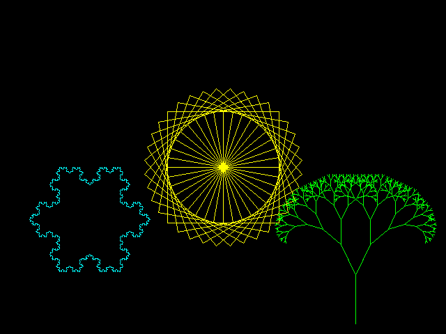

# riscv-basic

A toy "80s home computer" for QEMU's RISC-V `virt` board. It boots to a one-key
menu: **BASIC**, an 80s-style BASIC that is the machine's shell, or **LOGO**, a
turtle-graphics LOGO whose every line is compiled to RISC-V machine code by a
JIT written for this project. Rust, `no_std`, running in S-mode on top of
OpenSBI. Built for amusement.

## A session

This is real output from the booted machine (captured by the boot tests'
harness, with the typed lines echoed by the console as you would see them),
after pressing `1` at the boot menu. `BYE` reboots back to the menu:

```text
RISCV BASIC V0.1
32768 BYTES FREE

READY.
10 FOR I=1 TO 3
READY.
20 PRINT "HELLO";I
READY.
30 NEXT I
READY.
RUN
HELLO 1 
HELLO 2 
HELLO 3 
READY.
LIST
10 FOR I=1 TO 3
20 PRINT "HELLO";I
30 NEXT I
READY.
PRINT SQR(2);SIN(1)
 1.41421356  0.841470985 
READY.
A$="RISC-V": PRINT LEFT$(A$,4);"/";RIGHT$(A$,1)
RISC/V
READY.
POKE 2280652800,65: PRINT PEEK(2280652800)
 65 
READY.
NEW
READY.
10 INPUT "NAME";N$: PRINT "HI, ";N$
READY.
RUN
NAME? WORLD
HI, WORLD
READY.
PRINT 1/0
?DIVISION BY ZERO ERROR
READY.
```

## LOGO

Press `2` at the boot menu. This is the screen of the machine running LOGO (a
real capture taken through QEMU's monitor; the programs are in
[`home/examples/logo/`](home/examples/logo)):



```logo
to square :size
repeat 4 [fd :size rt 90]
end
to flower :size
repeat 36 [square :size rt 10]
end
flower 80
```

Every line you type is compiled to RV64 machine code and run, by a JIT written
for this project. The goldens for these pictures were not copied from the
implementation's own output: they come from a separate Python turtle renderer
(`home/scripts/verify_demo_images.py`), and the interpreter, the IR interpreter and the
compiled engine must all reproduce them pixel for pixel.

## Saving your work

`make home-run` and `make home-run-logo` attach a 2 MiB disk image, `disk.img` (created on
first use, never overwritten), shared by both languages. In BASIC: `SAVE "NAME"`,
`LOAD "NAME"`, `DIR`, `SCRATCH "NAME"`. In LOGO: `save "name`, `load "name`
(runs the file as if typed), `dir`, `erasefile "name`. Files survive `BYE` and
restarting QEMU. The format is an old-school floppy (directory, free map, chained
sectors; see `DESIGN.md`), and `python3 home/scripts/disk.py ls disk.img` reads it from
the host.

## What it is

- **A BASIC in the Microsoft/Commodore tradition.** Line-numbered programs
  (stored tokenized, `LIST` detokenizes), immediate mode, `RUN`, `GOTO`,
  `GOSUB`/`RETURN`, `ON ... GOTO/GOSUB`, `IF ... THEN`, `FOR`/`NEXT` with `STEP`,
  `DIM` and arrays (up to 3 dimensions), `DATA`/`READ`/`RESTORE`, `INPUT`,
  numbers (`f64`) and strings, the usual maths and string functions, `RND`,
  `TIMER`, `PEEK`/`POKE` on real physical addresses, `CLS`/`COLOR`/`LOCATE`
  (ANSI escapes), `TAB`/`SPC`, and Ctrl-C to stop a running program.
  Errors look like `?SYNTAX ERROR IN 20`. The language is specified in
  [BASIC.md](home/BASIC.md).
- **And LOGO.** Press `2` at the boot menu for a turtle-graphics LOGO (a UCBLogo
  subset, specified in [LOGO.md](home/LOGO.md)): `to ... end` procedures, recursion,
  dynamic scope, lists and words, `repeat`/`if`/`ifelse`/`run`, and a turtle
  that draws in the QEMU window (`make home-run-logo`). Every LOGO line is compiled to
  RV64 machine code before it runs (`.engine "ast` switches to the reference
  interpreter). Try `repeat 36 [repeat 4 [fd 80
  rt 90] rt 10]`.
- **A small kernel under it.** Boot in S-mode, 16550 UART console with line
  editing (backspace, Ctrl-U, Ctrl-C, arrow keys ignored), traps with a fatal
  report of `scause`/`sepc`/`stval`, a 10 ms timer tick, the FPU, and a heap.
  No paging, no processes: it is a home computer, not an OS. See
  [DESIGN.md](home/DESIGN.md).
- **Tested without hardware.** The interpreter runs on the host under
  `cargo test` against golden transcripts (`home/basic/tests/golden/`); QEMU boot
  tests type scripted sessions into the real kernel, including the demo
  programs below.

## Try it (macOS)

```sh
brew install qemu
rustup toolchain install     # reads rust-toolchain.toml: toolchain, components, riscv64 target
make home-run                # boots to a language menu: press 1 for BASIC (Ctrl-A then X quits QEMU)
```

Other commands:

```sh
make test             # host tests for the home-computer crates and the OS crates (no QEMU needed)
make home-kernel      # build the home-computer kernel ELF
make home-run-logo    # boot with a graphics window; press 2 at the menu for LOGO
                 # (menu keys 3 and 4 are JIT debugging aids: self-test, and a deliberate fault)
make home-debug       # boot paused, gdb stub on :1234
make home-boot-test   # the scripted QEMU boot tests, as CI runs them
make kernel           # the OS track: build the new kernel (see OS-ARCHITECTURE.md)
make os-boot-test     # the OS track: boot it headlessly and check its structured output
make check       # everything CI runs: fmt, tests, clippy, boot tests
```

## Programs to try

[`home/examples/`](home/examples) holds three programs. After `make home-run`, paste one into
the terminal (typed-ahead text is kept while BASIC is busy), then type `RUN`:

| Program | What it shows |
|---|---|
| [`guess.bas`](home/examples/guess.bas) | `INPUT`, `RND`, `IF`, `GOTO`, `STR$` |
| [`bottles.bas`](home/examples/bottles.bas) | `FOR ... STEP -1`, `GOSUB`, string functions |
| [`wumpus.bas`](home/examples/wumpus.bas) | arrays, `DATA`/`READ`, `GOSUB`, `INPUT`, a 20-room cave |

There is no `SAVE`/`LOAD` yet (the optional persistence milestone): programs
live only until the machine is switched off.

## Layout

| Path | What |
|---|---|
| `home/` | The finished home computer: BASIC and LOGO behind a boot menu (v0.2). Everything below up to `kernel/` lives inside it. |
| `home/basic/` | The interpreter. `no_std`, no hardware, no `unsafe`; tested on the host. |
| `home/console/` | Line editor and ANSI helpers. `no_std`, no hardware, no `unsafe`; tested on the host. |
| `home/logo/` | The LOGO language: reader, parser, reference interpreter. `no_std`, no hardware, no `unsafe`; tested against golden transcripts and images. |
| `home/rv64/` | A small RV64 assembler for the LOGO JIT. `no_std`, no `unsafe`; checked against LLVM and an emulator. |
| `home/turtle/` | Turtle graphics (canvas, rasteriser, turtle) for LOGO. `no_std`, no hardware, no `unsafe`; tested against golden images. |
| `home/cartfs/` | The SAVE/LOAD disk format. `no_std`, no `unsafe`; tested on the host. |
| `home/kernel/` | The home computer's boot code, UART driver, traps, timer, heap, framebuffer. Hosts the interpreter. |
| `home/examples/`, `home/docs/`, `home/scripts/` | Demo programs, the screenshot, and the home computer's QEMU boot tests. |
| `home/DESIGN.md`, `home/BASIC.md`, `home/LOGO.md` | Architecture and decision log; the two language specs. |
| `kernel/` | The OS track's kernel (S-series): multicore, virtual memory, user mode, capability syscalls, jobs and quotas, drivers' device authority. |
| `abi/`, `kcore/`, `proto/`, `memfs/`, `rt/`, `libc/`, `cfmt/`, `shell-core/`, `init/` | The OS track's other crates: syscall ABI, pure kernel core, wire protocols, memory filesystem, user runtime, C library (Rust, exporting the C ABI) and its printf core, shell core, user programs and servers. |
| `scripts/` | The OS track's headless boot and serial tests, and the other harness scripts. |
| `third_party/` | Vendored upstream sources, unmodified: Lua 5.4 and its test suite (`SOURCE.md` in each says where from, with checksums). |
| `tests/`, `reviews/` | The Lua acceptance script; independent design reviews and their reports. |
| `OS-ARCHITECTURE.md`, `SYSCALLS.md`, `INVARIANTS.md` | The OS track's spec, syscall reference and invariants. |
| `ROADMAP.md` | Milestones with acceptance criteria; the task tracker. |
| `CLAUDE.md` | Working agreement for AI coding sessions. |

## Limits

Strings are ASCII and at most 255 characters; the program area is 32768 bytes
(a line costs its tokens plus 5); all arrays together hold at most 40000
elements; `PEEK`/`POKE` are unchecked on purpose, so a bad `POKE` can corrupt
the machine and a bad address crashes it with a trap report, just as it should.
